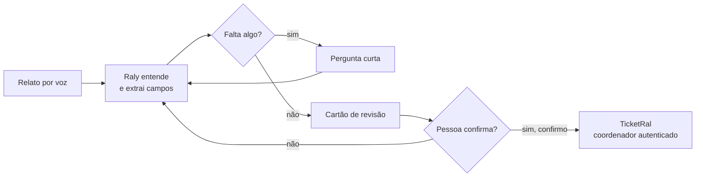

<div align="center">

# Raly

### Fale. O Raly organiza.

Agente de voz para quem trabalha em rodovias, com quatro agentes e acesso por perfil.


</div>

> **Projeto em desenvolvimento.** O site e o código estão em construção e mudam a cada entrega. Os dados são fictícios e nada aqui é produto final.

**Sumário:** [O que é](#o-que-é) · [Agentes](#os-quatro-agentes) · [Fluxo](#como-funciona-o-fluxo) · [Como rodar](#como-rodar) · [Acesso](#contas-e-níveis-de-acesso) · [Estrutura](#estrutura) · [Deploy](#deploy-railway) · [Limitações](#limitações)

## O que é

O **Raly** é um agente de **voz** para quem trabalha em rodovias (inspeção de tráfego, guincho, APH). O profissional fala o relato de uma ocorrência, sem digitar e sem tirar a atenção da via. O Raly organiza o que foi dito em campos claros, marca o que veio do relato e o que ainda falta, pergunta uma coisa por vez e entrega um resumo para **uma pessoa revisar e confirmar**.

O Raly **não decide gravidade, não aciona equipes e não inventa dados**: ele organiza informação e deixa a decisão com pessoas autorizadas.

## Os quatro agentes

A plataforma reúne quatro frentes, cada uma para um público e com **nível de acesso por perfil**:

| Agente | Para quem | O que faz | Quem acessa |
| --- | --- | --- | --- |
| **Raly** | Profissionais de campo | Agente de voz: recebe o relato, extrai campos, pergunta o que falta e prepara o cartão de revisão | Agente, coordenador, administrador |
| **Prazy** | Passageiros | Guia de dúvidas sobre a rodovia, só com conteúdo cadastrado | Qualquer pessoa logada |
| **TicketRal** | Coordenador de trânsito | Tickets operacionais com categoria, prioridade, equipe, trecho e histórico | Coordenador, administrador |
| **SmartDeskAI** | Passageiros e agentes | Atendimento que encaminha a demanda à área certa (aplicação própria do grupo) | Qualquer pessoa logada |

Também há a página **Ecossistema**, que explica cada agente, e o painel de **Administração** (usuários, auditoria e configurações), só para o administrador.

## Como funciona o fluxo




1. **Ouve:** o relato entra por voz (ou texto).
2. **Entende:** extrai tipo, rodovia, km, sentido, município e outros campos.
3. **Pergunta:** se falta algo importante, faz uma pergunta curta por vez. Nada é completado por suposição.
4. **Resume:** cada campo fica marcado como *informado*, *a confirmar* ou *não informado*.
5. **Espera um humano:** nada segue sem o "sim, confirmo".
6. **Passa adiante:** o coordenador autenticado abre o ticket no TicketRal.

## Tecnologias

- **React 19 + Vite** (front end), navegação por estado, sem React Router.
- **three.js:** mascote 3D do Raly e fundo 3D de rodovia.
- **Voz:** Web Speech API do navegador e, opcionalmente, um **servidor local em Python** (`raly-local/`) com voz offline (**Piper**), reconhecimento offline (**Whisper**) e modelo de linguagem local (**Ollama**).
- **Identidade visual:** paleta da capa do relatório da Sprint 1 (azul-marinho `#1b2e49` e azul-petróleo `#0b6f86`), tema escuro com vidro.

## Como rodar

Pré-requisito: Node.js 20 ou mais novo.

```bash
npm install
npm run dev
```

Abra o endereço que o Vite mostrar (normalmente `http://localhost:5173`). Para gerar a versão de produção: `npm run build`.

### Voz offline (opcional, Windows)

Sem o servidor local, o site usa a voz do navegador. Para ter vozes offline e microfone offline:

1. Instale o Python 3.12 (`winget install -e --id Python.Python.3.12`).
2. Dê dois cliques em `raly-local/iniciar.bat`. Na primeira vez ele cria o ambiente, instala os pacotes e baixa as vozes e o modelo do Whisper (precisa de internet).
3. Deixe a janela aberta e recarregue o site.
4. Para conferir: `http://127.0.0.1:8765/api/status`.

O servidor responde só a páginas locais (`localhost`) e nada sai do computador.

## Contas e níveis de acesso

O login é por **e-mail e senha**. O e-mail é validado só no formato; confirmar a caixa de e-mail exige um servidor. Perfis: **passageiro**, **agente de campo**, **coordenador de trânsito** e **administrador**.

- Quem cria conta pelo site entra como passageiro.
- Em instalação nova, sem nenhum usuário, a primeira conta criada vira administradora.
- Páginas sem permissão mostram a tela de login com o motivo.

> Autenticação **simulada no navegador** (senhas com PBKDF2 e sal no `localStorage`). Não oferece segurança real: na versão final ela passa para um servidor.

As contas e os dados de teste ficam em `src/demo/` e não aparecem no site. Veja `src/demo/LEIAME.md`.

## Estrutura

```text
src/
  components/   Header, Nav, RalyRosto (2D), RalyRosto3D, Fundo3D, RalyDock, PersonalizarVoz...
  pages/        Apresentacao, Agentes, Inicio, Raly, Prazy, TicketRal, SmartDeskAI,
                Consultas, Interacoes, Entrar, Conta, Admin, SobreRaly
  data/         agentes, permissões, conteúdo do Prazy, rodovias, trechos, fluxo, marca
  demo/         contas, tickets e interações de demonstração (fora da interface)
  utils/        comandos de voz, extração de campos, auth, useVoz, local (servidor local)
raly-local/     servidor local de voz (Piper + Whisper) e ponte para o Ollama
```

## Voz

- Painel flutuante do Raly em todas as telas (`Alt+R` abre, `Alt+V` liga o microfone).
- Perfis de voz pt-BR: **Feminina** (padrão), Padrão, Motorista, Alerta e Noturno.
- Ações críticas (confirmar revisão, criar ticket, mudar status) pedem "sim, confirmo".
- Exemplos de comandos: "abrir tickets", "abrir SmartDeskAI", "veículo parado no acostamento, DEMO-101, km 42, sentido interior", "corrigir sentido para capital", "confirmar revisão", "criar ticket", "perguntar ao Prazy …". A lista completa fica em Raly › Voz e comandos.
- O áudio não é gravado nem enviado a serviços externos quando o servidor local está ligado. Sem ele, o reconhecimento do Chrome/Edge usa um serviço online do navegador.

## Deploy (Railway)

1. No Railway, crie um projeto com **Deploy from GitHub repo** apontando para este repositório.
2. O `railway.json` já define o build (`npm ci && npm run build`) e o start (`npm run start`, que serve `dist/` em `0.0.0.0:$PORT`).
3. Em **Settings › Networking**, gere o domínio público.
4. O `raly-local/` roda só na máquina do usuário; no Railway o Raly usa a voz do navegador.

## O que funciona e o que é representado

**Funciona de verdade:** voz e comandos do Raly, extração por regras, cartão de revisão e edição de campos, tickets locais, Prazy com conteúdo cadastrado, níveis de acesso, mascote e fundo 3D.

**Apenas representado:** encaminhamento a equipes, fluxo de emergência, automações e a "revisão humana" (confirmação visual; nada é enviado).

## Limitações

- Sem backend próprio nem integração com sistemas da Motiva, CCO, telefonia, localização ou despacho.
- Os dados do Raly, TicketRal e Interações somem ao recarregar a página.
- Login simulado, sem segurança real.
- O núcleo local/offline do SmartDeskAI é evolução futura.
- O Raly não verifica, não decide gravidade e não aciona ninguém.

## Integrantes

| Integrante | RM |
| --- | --- |
| Rodrigo Wolkoff Giorgi | 556980 |
| Carlos Eduardo Mamede | 568269 |

Disciplina: Front End & Mobile Development - Turma 2TIAPR.
